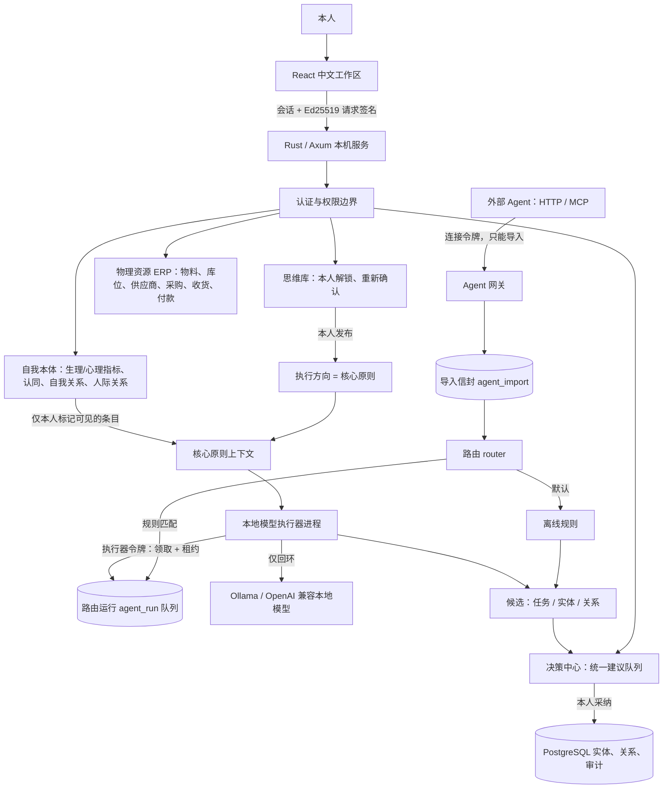

# 架构与文档映射（0.4）

## 重新思考后的总体定位

PRM 是一个基于本体论框架的个人信息、Resource（资源）与 Relation（关系）的管家与 Agent。R 有两层含义：

- **Resource**：可被使用、维护或消耗的对象——物料与资产、知识条目、执行方向、本地模型等。
- **Relation**：被具体化、可追溯的关系——与外界（他人、供应商、物品、任务）的关系，也包括**与自我的关系**（自我接纳、自我关怀、理想自我、边界……）。

每个实体同时落在三组相互独立的分类上，任何一组都不能代替另一组，也不能用来绕过权限：

| 维度 | 取值 | 含义 |
| --- | --- | --- |
| 世界 `worlds` | 自我、思维、数字、物理 | 事物存在于哪里，由类决定，可多值 |
| 评价维度 `values` | 需要、欲望、存在 | 原文的独立评价轴，本人选择 |
| 人生场景 `scenes` | 自我、情感、生活、工作、健康、学习、财务、社交 | 属于人生的哪个部分，本人选择，有类默认值 |

本体的上位范畴采用会计信息系统中成熟的 **REA 本体**（Resource-Event-Agent，McCarthy 1982），并扩展了承诺、关系与观察：

| 范畴 | 类 |
| --- | --- |
| 主体 Agent | 自我本体、人物、供应商 |
| 资源 Resource | 资源/物料、库位、知识条目、执行方向、会话、本地模型、路由规则 |
| 事件 Event | 消息、库存流水、现金流水、互动记录、Agent 导入、路由运行 |
| 承诺 Commitment | 任务、采购订单、采购订单行、建议 |
| 关系 Relation | 自我认同、自我关系、人际关系 |
| 观察 Observation | 生理自我指标、心理自我认定 |

关系（谓词）按层组织：自我关系、外部关系、资源关系（ERP）、数字关系、来源追溯。所有类与谓词定义在 `src/ontology.rs` 的注册表中，是唯一来源：数据库约束、后端校验和界面展示都从它派生。

## 与原文的对应

| 原文章节 | 约束 | 当前实现 |
| --- | --- | --- |
| 1.2、2.4 | 三个世界交叉；不能与三种价值一一对应 | `worlds` 多值标签；`value_axes` 独立；新增与二者独立的 `scenes` |
| 2.3、7.1–7.4 | 注意力、独立判断、信任与意义不能直接货币化 | 思维库私有；心理测量只是本人观察，不合成幸福分 |
| 3.1、3.4–3.5 | 实物、金融索取权、现金收入和重估不同 | 库存数量与现金流水分开；采购订单是承诺，收货与付款是独立事件 |
| 3.2 | 形成并维护能力，而非仅完成任务 | 原则、目标、反思；自我效能、成长意图等自我记录 |
| 3.3 | 生成不等于验证，更不等于已接受的服务 | 导入、候选建议、本人采纳、纳入本体四个阶段 |
| 3.4、6.3 | 控制权、授权、退出和责任 | 本人会话、执行器、外部 Agent 三类凭证隔离；外部令牌可撤销 |
| 3.6、7、13 | 多维反馈与可修订的判断 | 指标趋势、关系满意度、互动流水；无自动优化个人价值观 |
| 4.2、5.2 | 后果越深，权限与责任要求越高 | AI 只提交候选；库存、现金、关系与本体写入只能由本人确认 |
| 6.1、6.3 | 真实性、来源、可验证性和代理边界 | 导入原样保存；`derived_from` 溯源；候选按本体约束校验 |
| 14 | 经济目的不能外包 | 核心原则只能由本人从思维库发布；本地模型只能引用，不能修改 |

## 系统结构

首版是模块化单体。一个 Rust 进程提供静态界面、身份验证、业务服务、规则分析、路由与本体约束，数据库操作由单个互斥锁串行化。PRM 服务自身不发起任何对外网络请求；调用本地模型的是独立的执行器进程。

## 模块边界

- `src/ontology.rs`：本体注册表（类、谓词签名、世界、评价维度、场景、范畴、关系层），派生校验、`schema()` 和启动时的数据库约束同步。
- `src/store.rs`：PostgreSQL 读写、乐观版本、事务、只追加审计。`src/database.rs`：同步驱动适配。`src/legacy.rs`：旧 SQLite 只读导入。
- `src/auth.rs`、`src/crypto.rs`、`src/vault.rs`、`src/security.rs`：账户、加密思维库、本人发布、只读授权与请求签名。
- `src/self_model.rs`：自我本体——量表目录（只含元数据与出处）、测评记录、自我认同、自我关系、Agent 可见性、核心原则预览。
- `src/relationships.rs`：与他人的关系——人物、人际关系（IOS 亲密度、RAS 满意度、联系节奏）、互动流水。
- `src/erp.rs`：物理资源 ERP——物料主数据、库位、供应商、采购订单状态机、收货、付款、库存与现金流水。
- `src/operations.rs`：通用实体创建（本人表单与采纳的候选共用同一套校验）、任务、执行方向撤回、关系、导出、演示数据。
- `src/analysis.rs`：离线分析规则、统一建议队列、候选校验与本人采纳。
- `src/agents/`：`credentials`（外部 Agent 令牌）、`gateway`（导入接口）、`router`（本地模型、路由规则、核心原则上下文）、`executor`（离线规则执行与执行器任务接口）。
- `web/`：中文界面。`App.tsx` 是外壳（导航、场景筛选、对话框），`web/pages/` 各页面，`web/dialogs/` ERP 与关系对话框，`web/Editor.tsx` 通用对话框。
- `scripts/prm-model-worker.mjs`：本地模型执行器；`scripts/prm-mcp.mjs`：MCP 工具桥；`docs/agent-openapi.json`：HTTP 导入接口说明。

## 本人驱动的闭环

1. 本人在思维库建立原则、目标或反思，输入口令并明确确认；把需要被遵循的原则发布为执行方向（可限定场景）。
2. 本人在自我本体记录测评、身份认同与自我关系，并逐条决定哪些可以作为背景提供给本地模型。
3. 外部 Agent 通过 HTTP 或 MCP 导入资源、关系、消息、人物与任务；导入原样保存。
4. 路由按规则选择离线规则或本地模型。本地模型在“核心原则上下文”下工作：已发布的执行方向 + 本人标记可见的自我记录 + 固定规则。
5. 结果统一成为决策中心里的候选建议，并记录来源、执行方式和引用的原则。
6. 本人逐条审阅、修改标题后采纳；系统按本体约束重新校验后写入实体或关系，并以 `derived_from` 记录来源。
7. 本人执行任务、办理收货付款、记录互动，再回到思维库与自我本体做独立反思。

## 后续扩展边界

内置题目的问卷（需要可合法使用的中文版本）、Tauri 桌面封装、Windows Hello/FIDO2 逐次确认、日历与 IM 连接器、预算与复式记账、加密备份恢复界面、跨设备同步，都可以在现有注册表与权限边界上逐层扩展。外部连接器必须继续使用受限的外部 Agent 身份；私密思维库不得成为任何 Agent 的检索源。多设备、云模型和高后果物理执行会改变威胁模型，需要独立设计，当前版本没有隐式打开这些能力。
